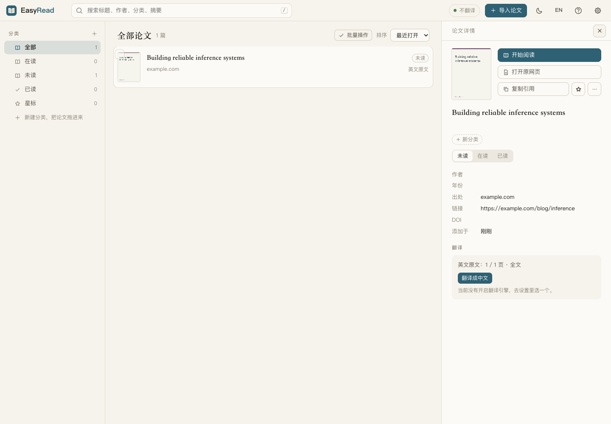

# 博客和网页文章

在“导入论文或博客”中粘贴网页链接，选择“自动识别”即可。普通网页找不到 PDF 时会作为网页文章导入；也可以选择“网页 / 博客（保留原排版）”，直接保存网页，即使页面里有 PDF 链接。原有 arXiv、DOI、论文标题和 PDF 导入保持原流程。命令行也支持 `easyread import https://example.com/blog/post`。

默认以原网页排版阅读：保存页面 HTML、样式、图片和链接，只替换文字节点。原文、译文和双语使用顶栏的切换按钮。图片里的文字和代码不翻译。网页自身的脚本、表单和嵌入页面不在快照中运行，因此交互组件可能变成静态内容。

直接在原网页排版上选中文字，即可使用 EasyRead 的荧光笔、下划线、笔记、提问和引用到 AI 对话；支持跨粗体、链接和跨段选区。点击划线可改色、改成笔记或删除；笔记和 AI 在侧栏打开，正文保持博客原排版。点击段落可打开共用操作条，右键菜单支持编辑译文；查找和目录也定位到原网页。顶栏的“网页排版 / EasyRead 风格”可切换原网页与 EasyRead 的阅读排版；两种视图都支持批注，切换时尽量保留当前段落，并按文章记住排版选择。旧版两种视图产生的批注沿用相同段落 ID 和引用文字。博客和论文一样支持分类、星标、阅读状态、回收站和离线 HTML 导出。原网页快照保留英文；译文单独保存，切换语言不会改写快照。

静态网页不需要浏览器。像 [GLM 推理基础设施这篇博客](https://z.ai/blog/glm-built-its-inference-infrastructure) 这样的动态网页，需要本机安装 Chrome、Chromium 或 Edge，EasyRead 会使用独立的临时浏览器目录加载正文，不使用日常浏览器的登录会话。目前不支持需要登录、验证码或必须交互才能展开的正文。

样式和图片会尽量内嵌保存，单篇资源下载上限为 32 MB / 80 个请求。资源下载失败或超过上限时保留远程地址，这些资源离线时可能不可见。网页的“页数”表示翻译批次，每批约 6000 字符，不对应纸张页码；导入框的 PDF 页码范围不应用于博客。读博客原文无需调用模型。

文献库自动显示博客封面：优先采用网页声明的 Open Graph / Twitter 图片，其次采用正文中可读取的图片；没有可用图片时生成包含文章标题和站点的封面。封面保存在本地，已有博客会在文献库加载时从已保存的快照补齐，无需重新导入或联网。

## 存储

沿用每篇一个目录和现有 `paper.json`、`reader.json`、`discussion.json`、`item.json`、`job.json`。网页使用 `meta.source_type = "web"`，保存 `source.html`，没有 `source.pdf` 或 PDF 原页图。ID 为带 `web:` 前缀的导入 URL 的 SHA-256 前 12 位（忽略锚点）；重复导入同一 URL 会复用原条目，保留笔记和译文。

正文块保持稳定 ID，`web_runs` 保存原 DOM 文字片段的 `id`、`en` 和 `zh`。`source.html` 内的 `data-easyread-run` 与片段对应；阅读器只通过 `textContent` 更新文字，不把模型输出当作 HTML。模型逐批返回完整片段映射，通过校验后原子写入；失败批次可重试。用户编辑仍保存在 `reader.json`，重译不会覆盖。运行时按文字片段建立原文／译文的 DOM 映射，批注仍使用现有 `anchor`、`key`、`quote`、`prefix`、`suffix`、`side` 和跨段 `parts` 字段，不另建存储。网页脚本继续禁用；选区、键盘和菜单由父阅读器的可信代码处理，模型输出只作为文字显示。
